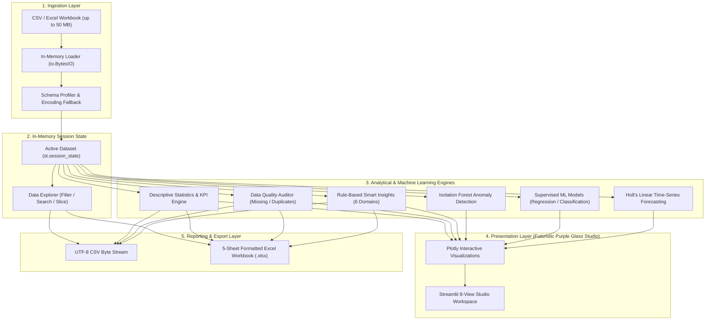

# InsightFlow

[](https://www.python.org/)
[](https://streamlit.io/)
[](https://pandas.pydata.org/)
[](https://numpy.org/)
[](https://scikit-learn.org/)
[](https://plotly.com/)
[](https://openpyxl.readthedocs.io/)
[](tests/)
[](LICENSE)

> **Turn Data Into Decisions**  
> *Smart Business Data Analytics & Decision Support System*
> 
> InsightFlow is an exploratory business data analytics and decision intelligence workspace built with Python and Streamlit. Designed around a **Futuristic Purple Glass Analytics Studio** interface, InsightFlow transforms heterogeneous CSV and Excel spreadsheets into structured operational intelligence through in-memory profiling, multi-dimensional slicing, rule-based automated insights, machine learning, and multi-sheet formatted Excel reporting.

---

## 📑 Table of Contents

- [Problem Statement](#problem-statement)
- [Application Interface & Screenshots](#application-interface-screenshots)
- [System Architecture & Dataflow](#system-architecture-dataflow)
- [Key Features](#key-features)
- [Machine Learning Capabilities](#machine-learning-capabilities)
- [Technology Stack](#technology-stack)
- [Project Architecture & Directory Structure](#project-architecture-directory-structure)
- [Installation & Setup](#installation-setup)
- [Zero-Setup Quick Start (Sample Dataset)](#zero-setup-quick-start-sample-dataset)
- [How to Upload & Analyze Datasets](#how-to-upload-and-analyze-datasets)
- [Automated Testing & Quality Assurance](#automated-testing-quality-assurance)
- [Current Limitations](#current-limitations)
- [Future Roadmap](#future-roadmap)
- [Author & Acknowledgments](#author-acknowledgments)

---

## 📌 Problem Statement

Organizations routinely generate vast volumes of operational, sales, and logistical data spread across disparate CSV and Excel spreadsheets. However, translating raw rows and columns into timely, high-confidence business decisions presents recurrent challenges:

1. **Ingestion & Data Quality Friction:** Inconsistent column naming, character encoding quirks (UTF-8, Latin-1, CP1252), missing cells, and duplicate rows distort calculations before analysis begins.
2. **Analysis Fragmentation:** Analysts must frequently toggle between spreadsheet formulas, ad-hoc Python scripts, and manual charting tools to calculate basic statistics and KPIs.
3. **Black-Box Analytics:** Dashboards frequently display numbers without explaining *why* metrics skew, which outliers warrant investigation, or what underlying assumptions govern calculations.
4. **Data Privacy & Governance:** Cloud-hosted analytics tools transmit sensitive commercial data to external servers, creating governance and compliance overhead.

**InsightFlow addresses this** by providing a unified, self-contained, and local analytics workspace where users can ingest datasets, explore dimensions, audit data quality, uncover statistical anomalies, train predictive models, and export multi-sheet reports—all executing in-memory on your local machine with zero external cloud transmission.

---

## 🖼️ Application Interface & Screenshots

InsightFlow features an immersive **Futuristic Purple Glass Analytics Studio** visual design with deep midnight navy surfaces, translucent glass panels, subtle ambient violet-cyan glows, and responsive interactive Plotly charts.

### 1. Executive Overview Dashboard

- **Studio Welcome Banner:** Real-time dataset telemetry and system health status.
- **Dynamic Quick-Access Cards:** Direct routing to all 8 operational workspace views.
- **Capability Matrix:** Visual onboarding detailing data ingestion boundaries, analytics engines, and machine learning modules.

### 2. Robust Data Ingestion & Schema Profiling

- **Multi-Format Support:** In-memory streaming loader supporting `.csv`, `.xlsx`, and legacy `.xls` workbooks up to 50 MB.
- **Workbook Sheet Selector:** Interactive dropdown to inspect and select specific sheets in multi-sheet Excel files.
- **Dataset Preview & Schema Breakdown:** Inspects the first 10 rows and reports inferred column types and memory footprint.

### 3. Business Analytics & Decision Intelligence

- **Executive KPI Cards:** Inferred Revenue, Order Volume, Average Order Value (AOV), or primary dimensional summaries.
- **Comprehensive Quality Audit:** Completeness percentage, missing cell breakdown, duplicate row counts, and column integrity.
- **Correlation Discovery:** Pearson correlation matrix with non-constant feature isolation and top co-movement pairs.

### 4. Machine Learning & Predictive Modeling

- **Isolation Forest Anomaly Detection:** Outlier isolation with inverted Anomaly Severity Index (0–100%) and 2D scatter visualization.
- **Supervised Model Training:** Automatic task inference (Classification vs. Regression), imputation, and feature importance extraction.
- **Time-Series Forecasting:** Univariate Holt's Linear Exponential Smoothing with expanding 95% confidence intervals.

---

## 🏛️ System Architecture & Dataflow

InsightFlow operates strictly in memory, ensuring that uploaded business datasets are never persisted to disk or transmitted across external networks:



---

## 🚀 Key Features

### 1. Robust Data Ingestion & Schema Profiling
- **Multi-Format Support:** Ingest CSV (`.csv`), Excel OpenXML (`.xlsx`), and Legacy Excel (`.xls`) workbooks up to 50 MB.
- **In-Memory Streaming:** Processes files in-memory using byte buffers with zero persistent disk caching or cloud transmission.
- **Encoding Auto-Detection:** Automatically handles UTF-8, Latin-1, and Windows-1252 character encodings.
- **Workbook Sheet Selector:** Automatically inspects multi-sheet workbooks and prompts the user to select the active sheet.
- **Schema & Memory Footprint:** Details detected column data types, row/column counts, and RAM footprint.

### 2. Interactive Data Explorer
- **Non-Destructive Slicing:** Preserves the underlying active dataset while allowing users to filter, sort, and project columns interactively.
- **Case-Insensitive Global Search:** Searches across string representations of all dataset columns simultaneously.
- **Multi-Dimensional Filters:** Categorical multiselect filtering and numerical double-ended range sliders.
- **Dynamic Active Filter Pills:** Real-time visual indicator displaying active search criteria, category selections, and numeric ranges.
- **Retention Diagnostics:** Displays original rows, filtered rows, visible columns, and match retention rate (%).

### 3. Business Analytics Engine
- **Descriptive Statistics:** Calculates central tendency (Mean, Median, Mode), dispersion (Standard Deviation, Variance), and range quartiles (Q1, Q2, Q3, IQR).
- **Data Quality Audit:** Measures overall completeness percentage, missing cells per column, duplicate row counts, and column-by-column integrity scores.
- **Business KPIs:** Identifies revenue and order value metrics when transaction columns are present; falls back to primary dimensional summaries for non-sales datasets.
- **Correlation Discovery:** Generates Pearson correlation matrices, isolates non-constant features, and extracts top positive and negative co-movements.

### 4. Advanced Analytics & Trajectory Tracking
- **Trend Analysis:** Groups temporal metrics across Daily, Weekly, Monthly, and Yearly periods with period-over-period percentage growth and trajectory badges (`Increasing`, `Decreasing`, `Stable`).
- **Comparative Benchmarks:** Category-level performance comparisons with optional secondary cross-tabulation matrices and grouped bar charts.
- **Segmentation Profiling:** Categorical segmentation and numerical quantile/range tiering (Tertiles, Quartiles, Quintiles) with dominant segment detection.
- **Leaderboard Performance Rankings:** Isolates top-performing and lowest-performing groups with minimum-rank tie handling and plain-English evaluation explanations.
- **Bivariate Regression Analysis:** Calculates Pearson $r$, $R^2$ goodness-of-fit, covariance, and linear regression formulas ($y = mx + b$).

### 5. Rule-Based Smart Insights Engine
- **Automated Narrative Findings:** Synthesizes actionable, rule-based observations across six analytical categories (Data Quality, Numerical Skew, Categorical Concentration, Correlations, Trends, Business Performance) using deterministic statistical thresholds.
- **Evidence Values & Badges:** Pairs every finding with numerical evidence chips and severity indicators (`Critical`, `Warning`, `Positive`, `Info`).
- **Contextual Explanations:** Includes structured *"Why this matters"* guidance explaining operational business impacts.

### 6. Machine Learning & Predictive Intelligence
- **Isolation Forest Anomaly Detection:** Multi-dimensional outlier detection with an inverted Anomaly Severity Index (0–100%) and 2D scatter isolation.
- **Supervised Predictive Modeling:** Automatic task inference (Classification vs. Regression), target leakage prevention, median/mode imputation, and train/test splitting.
- **Ensemble & Baseline Algorithms:** Linear Regression, Random Forest Regressor, Logistic Regression, and Random Forest Classifier with MDI feature importance extraction.
- **Time-Series Forecasting:** Univariate Holt's Linear Exponential Smoothing with expanding 95% confidence intervals and minimum-history integrity checks.
- **Evaluation Diagnostics:** Complete metrics suite (MAE, RMSE, $R^2$, Accuracy, Precision, Recall, F1-Score, Confusion Matrix) and model explainability documentation.

### 7. Executive Reports & Multi-Format Export
- **UTF-8 CSV Exports:** Download either the complete active dataset or the currently sliced Data Explorer subset.
- **Multi-Sheet Openpyxl Workbook:** Generates a formatted `.xlsx` workbook with frozen panes, styled navy headers, and auto-fitted columns across 5 analytical sheets:
  1. `Dataset` (Active raw records)
  2. `Statistical Summary` (Descriptive metrics)
  3. `Data Quality` (Completeness scorecard & column audit)
  4. `Business KPIs` (Inferred performance indicators & distributions)
  5. `Smart Insights` (Rule-based narrative findings, severity levels, and evidence chips)

---

## 🤖 Machine Learning Capabilities

| Capability | Algorithm | Implementation | Primary Use Case |
| :--- | :--- | :--- | :--- |
| **Anomaly Detection** | Isolation Forest (`IsolationForest`) | `scikit-learn` | Multi-dimensional statistical outlier isolation across numerical features |
| **Predictive Regression** | Linear Regression (`LinearRegression`) | `scikit-learn` | Continuous target baseline modeling and coefficient extraction |
| **Predictive Regression** | Random Forest Regressor (`RandomForestRegressor`) | `scikit-learn` | Non-linear continuous modeling with MDI feature importance |
| **Predictive Classification**| Logistic Regression (`LogisticRegression`) | `scikit-learn` | Discrete class probability baseline modeling |
| **Predictive Classification**| Random Forest Classifier (`RandomForestClassifier`)| `scikit-learn` | Non-linear multi-class categorization and feature importance |
| **Time-Series Forecasting** | Holt's Linear Exponential Smoothing | `numpy` / `pandas` | Univariate level and trend extrapolation with expanding 95% prediction intervals |

---

## 🛠️ Technology Stack

| Layer | Component | Version | Purpose |
| :--- | :--- | :--- | :--- |
| **Application & UI** | [Streamlit](https://streamlit.io/) | `1.35.0+` | Reactive web application framework, state management, view routing |
| **Visual Theming** | Custom CSS Variables | — | Futuristic Purple Glass Studio design system, metric cards, layouts |
| **Data Manipulation** | [Pandas](https://pandas.pydata.org/) | `2.2.0+` | DataFrame wrangling, in-memory slicing, type inference, aggregations |
| **Numerical Computing** | [NumPy](https://numpy.org/) | `1.26.0+` | Vectorized mathematical operations, residual calculation, variance |
| **Data Visualization** | [Plotly](https://plotly.com/python/) | `5.22.0+` | Interactive charts, distribution plots, heatmaps, scatter diagrams |
| **Machine Learning** | [Scikit-learn](https://scikit-learn.org/) | `1.3.0+` | Isolation Forest, Random Forest, Linear/Logistic models, metrics |
| **Excel Workbook Compilation** | [Openpyxl](https://openpyxl.readthedocs.io/) | `3.1.2+` | Formatted multi-sheet `.xlsx` report generator with styles |
| **Automated Testing** | Python `unittest` | Standard Library | Automated regression verification across 10 test modules |

---

## 🏗️ Project Architecture & Directory Structure

InsightFlow is structured following the **Separation of Concerns (SoC)** principle. UI presentation elements, statistical analytics, machine learning pipelines, visualization builders, and reporting routines are organized into dedicated, decoupled modules:

```text
InsightFlow/
├── .gitignore                      # Git exclusion rules (venv, bytecode, secrets, user data)
├── .streamlit/
│   └── config.toml                 # Streamlit UI theme and headless server configuration
├── LICENSE                         # Standard MIT License (Vedanti Rajendra Divekar)
├── README.md                       # Comprehensive project documentation and developer guide
├── requirements.txt                # Production Python dependencies
├── app.py                          # Streamlit application bootstrap and page orchestration
├── sample_business_sales.csv       # Bundled 150-record retail sales sample dataset
├── src/
│   ├── __init__.py                 # Marks src as a Python package
│   ├── ui/                         # Presentation layer (theming, sidebar, views)
│   │   ├── __init__.py
│   │   ├── header.py               # Top branding header and status badges
│   │   ├── sidebar.py              # Sidebar navigation radio menu and dataset status card
│   │   ├── styles.py               # Futuristic Purple Glass Studio design system, metric cards, and layout
│   │   └── views/                  # View controllers
│   │       ├── __init__.py
│   │       ├── overview.py         # System capabilities and workflow onboarding
│   │       ├── upload.py           # Ingestion, validation, preview, and schema breakdown
│   │       ├── explorer.py         # Search, multi-filtering, sorting, column projection
│   │       ├── analytics.py        # Business KPIs, descriptive statistics, quality audit
│   │       ├── advanced_analytics.py # Trends, comparisons, segmentation, leaderboards
│   │       ├── ml_insights.py      # Anomaly detection, predictive ML, and forecasting
│   │       ├── insights.py         # Rule-based observations, evidence chips, takeaways
│   │       ├── reports.py          # UTF-8 CSV downloads, multi-sheet Excel workbook
│   │       └── placeholder.py      # Fallback placeholder view
│   ├── data/                       # Ingestion, validation, and exploration engine
│   │   ├── __init__.py
│   │   ├── loader.py               # In-memory streaming loader (CSV, XLSX, XLS)
│   │   ├── validator.py            # Extensions, size limits, and DataFrame integrity checks
│   │   └── explorer.py             # Functional search, multi-filter, sort, and slice logic
│   ├── analytics/                  # Business analytics & intelligence routines
│   │   ├── __init__.py
│   │   ├── statistics.py           # Central tendency, dispersion, and quartile metrics
│   │   ├── quality.py              # Completeness scores, missing cells, duplicate audits
│   │   ├── kpi.py                  # Business KPIs, inferred revenue/AOV, distributions
│   │   ├── correlation.py          # Pearson correlation matrix and top pairwise relationships
│   │   ├── advanced.py             # Trends, growth rates, comparative benchmarks, quantiles
│   │   └── insights.py             # Rule-based insight generation across 6 categories
│   ├── ml/                         # Machine learning & predictive intelligence engine
│   │   ├── __init__.py
│   │   ├── anomaly_detection.py    # Isolation Forest multi-dimensional outlier detection
│   │   ├── prediction.py           # Automated classification & regression model training
│   │   ├── forecasting.py          # Holt's linear exponential smoothing with confidence intervals
│   │   └── evaluation.py           # MAE, RMSE, R2, accuracy, precision, recall, F1, confusion matrix
│   ├── visualization/              # Reusable Plotly chart generation modules
│   │   ├── __init__.py
│   │   ├── charts.py               # Distributions, categorical frequency, heatmaps, trends
│   │   ├── advanced_charts.py      # Trend trajectories, comparative bars, donut segments, rankings
│   │   └── ml_charts.py            # Anomaly scatter, feature importance, forecast confidence bands
│   ├── reports/                    # Multi-format reporting and data export engines
│   │   ├── __init__.py
│   │   ├── csv_export.py           # UTF-8 CSV byte stream generation
│   │   ├── excel_export.py         # Formatted 5-sheet Excel workbook generator (Openpyxl)
│   │   └── pdf_export.py           # PDF capability auditing and limitation handling
│   └── utils/                      # Cross-cutting utility functions and formatters
│       └── __init__.py
├── docs/                           # Documentation, screenshots, and QA reports
│   ├── images/                     # Production UI interface screenshots
│   │   ├── overview_dashboard.png
│   │   ├── data_upload.png
│   │   ├── business_analytics.png
│   │   └── ml_predictive_intelligence.png
│   └── qa_report.md                # Comprehensive Stage 16 QA & readiness audit report
├── scripts/                        # Automation and developer utilities
│   └── dev/                        # Local headless browser capture scripts (git-ignored)
└── tests/                          # Automated unit test suite (105 passing unit tests)
    ├── __init__.py
    ├── test_data_ingestion.py      # Validation, CSV/Excel parsing, sheet selection tests
    ├── test_data_explorer.py       # Global search, multi-filtering, sorting, projection tests
    ├── test_analytics.py           # Stats, data quality, KPIs, and correlation tests
    ├── test_advanced_analytics.py  # Trends, comparative analysis, quantiles, rankings tests
    ├── test_insights.py            # Rule-based insights, evidence, and categorization tests
    ├── test_ml_features.py         # Anomaly detection, prediction, forecasting, evaluation tests
    ├── test_reports.py             # CSV, 5-sheet Excel workbook, and PDF audit tests
    ├── test_sidebar_sync.py        # Streamlit session state and sidebar indicator synchronization
    ├── test_stage16_full_qa_audit.py # End-to-end QA audit, data corruption, and security tests
    └── verify_full_system.py       # Standalone system verification suite
```

---

## 💻 Installation & Setup

### 1. Prerequisites
- **Python:** 3.10, 3.11, or 3.12 installed on your system ([Download Python](https://www.python.org/)).
- **Git:** Installed on your system ([Download Git](https://git-scm.com/)).
- **Operating System:** Windows, macOS, or Linux.

### 2. Clone the Repository
```bash
git clone https://github.com/vedantidivekar83-web/insightflow-business-analytics.git
cd insightflow-business-analytics
```

### 3. Create and Activate Virtual Environment

**On Windows (PowerShell):**
```powershell
python -m venv .venv
.\.venv\Scripts\Activate.ps1
```

**On macOS / Linux:**
```bash
python3 -m venv .venv
source .venv/bin/activate
```

### 4. Install Dependencies
```bash
pip install --upgrade pip
pip install -r requirements.txt
```

---

## ⚡ Zero-Setup Quick Start (Sample Dataset)

InsightFlow includes a bundled sample dataset ([`sample_business_sales.csv`](sample_business_sales.csv)) in the project root containing 150 retail transactions across products, categories, revenue, quantities, and dates:

1. **Start the application:**
   ```bash
   streamlit run app.py
   ```
   *Note for Windows users:* If port 8501 is reserved by Windows exclusion ranges, specify port 8502:
   ```bash
   streamlit run app.py --server.port 8502
   ```

2. **Test Drive the Capabilities:**
   - In the sidebar, navigate to **📤 Data Upload**.
   - Upload [`sample_business_sales.csv`](sample_business_sales.csv) from the project directory.
   - Click **🔍 Data Explorer** to filter by categories or search keywords.
   - Open **📈 Analytics** to inspect automatically detected Revenue KPIs and the Data Quality Audit.
   - Run **🤖 Machine Learning** to trigger Isolation Forest anomaly detection or train predictive models.
   - Go to **📋 Reports** to export the cleaned data or generate a multi-sheet formatted Excel workbook.

---

## 📖 How to Upload and Analyze Datasets

1. **Upload Dataset:**
   - In the sidebar navigation, select **📤 Data Upload**.
   - Drag and drop or browse for any `.csv`, `.xlsx`, or `.xls` file (up to 50 MB).
   - If uploading an Excel file with multiple sheets, choose the desired sheet from the dropdown.
   - Inspect the first 10 rows and review the automatically detected column data types.
2. **Explore & Slice Data:**
   - Select **🔍 Data Explorer** to filter by categories, narrow numerical ranges with sliders, search keywords across all columns, sort fields, or select specific columns to view.
3. **Review Business Analytics:**
   - Select **📈 Analytics** to inspect central tendencies (Mean, Median, Quartiles), review the comprehensive Data Quality Audit (missing cells, duplicates), and evaluate correlation matrices.
4. **Inspect Advanced Analytics:**
   - Select **🔬 Advanced Analytics** to track period-over-period growth rates (Daily/Weekly/Monthly), benchmark categories, create quantile segmentation tiers, and view performance leaderboards.
5. **Execute Machine Learning:**
   - Select **🤖 Machine Learning**:
     - *Anomaly Detection:* Select features to flag outliers via Isolation Forest.
     - *Predictive Modeling:* Pick a target column; InsightFlow auto-detects Regression vs. Classification, trains a model, and displays evaluation metrics alongside feature importances.
     - *Forecasting:* Select a temporal dimension and metric to extrapolate future values with 95% confidence intervals.
6. **Read Contextual Smart Insights:**
   - Select **💡 Smart Insights** to review automated rule-based business takeaways, anomalies, and categorized observations.
7. **Export Deliverables:**
   - Select **📋 Reports** to download the cleaned active/filtered dataset as a UTF-8 CSV or generate a formatted 5-sheet `.xlsx` Excel report.

---

## 🧪 Automated Testing & Quality Assurance

InsightFlow includes an automated unit test suite executed via Python's standard `unittest` framework:

```bash
python -m unittest discover tests
```

To run with verbose output detailing each test:
```bash
python -m unittest discover tests -v
```

### Verified Test Suite Breakdown (105 Passing Tests)

| Test Suite Module | Target Architecture Domain | Tests | Status |
| :--- | :--- | :---: | :---: |
| [`test_data_ingestion.py`](tests/test_data_ingestion.py) | In-memory stream parsing, multi-sheet Excel inspection, encoding fallback, schema validation | 6 | **Passing** |
| [`test_data_explorer.py`](tests/test_data_explorer.py) | Non-destructive slicing, case-insensitive global search, categorical multiselect, range sliders | 9 | **Passing** |
| [`test_analytics.py`](tests/test_analytics.py) | Central tendencies, dispersion, quartiles, data quality audit, revenue/AOV inference | 12 | **Passing** |
| [`test_advanced_analytics.py`](tests/test_advanced_analytics.py) | Temporal trends, period-over-period growth, comparative benchmarking, quantile tiers, ranking | 23 | **Passing** |
| [`test_insights.py`](tests/test_insights.py) | Rule-based insight generation across 6 domains, severity badges, numerical evidence chips | 9 | **Passing** |
| [`test_ml_features.py`](tests/test_ml_features.py) | Isolation Forest anomaly detection, automated regression/classification, Holt's linear forecasting | 16 | **Passing** |
| [`test_reports.py`](tests/test_reports.py) | UTF-8 CSV byte stream generation, 5-sheet Openpyxl Excel compilation, PDF limitation disclosure | 7 | **Passing** |
| [`test_sidebar_sync.py`](tests/test_sidebar_sync.py) | Session state dataset tracking, active badge indicators, long filename truncation handling | 3 | **Passing** |
| [`test_stage16_full_qa_audit.py`](tests/test_stage16_full_qa_audit.py) | Comprehensive end-to-end user workflows, 50,000-row stress limits, path/secret security audit | 20 | **Passing** |
| **Total Verified Test Count** | **Full System Quality Assurance** | **105** | **100% Passing** |

*Note: An additional standalone integration verification script ([`verify_full_system.py`](tests/verify_full_system.py)) is provided for non-unittest command-line verification.*

---

## ⚠️ Current Limitations

1. **PDF Export Engine:**
   - PDF generation is currently not implemented because third-party PDF rendering libraries (`reportlab` or `fpdf2`) are not bundled in `requirements.txt`.
   - Full reporting capability is actively available via universal UTF-8 CSV exports and multi-sheet formatted Excel workbooks (`.xlsx`). The user interface transparently communicates this status.
2. **Minimum Dataset Thresholds:**
   - Supervised predictive modeling requires at least 10 observations and 1 predictor feature.
   - Time-series forecasting requires at least 5 historical period intervals.
   - Isolation Forest anomaly detection requires at least 4 numerical records.
3. **Univariate Time-Series Scope:**
   - The statistical baseline forecasting model utilizes Holt's Linear Exponential Smoothing. Macroeconomic factors or multi-variable seasonal interactions are not modeled in univariate baselines.

---

## 🔮 Future Roadmap

- [ ] **Automated PDF Report Generation:** Integrate a lightweight PDF compiler once approved.
- [ ] **Advanced Anomaly Ensembles:** Support One-Class SVM and Local Outlier Factor (LOF).
- [ ] **Multivariate Deep Forecasting:** Autoregressive multi-seasonal forecasting for complex supply chain datasets.
- [ ] **Database & Cloud Connectors:** Direct connector integration for PostgreSQL, Snowflake, and BigQuery.
- [ ] **Custom KPI Rule Builder:** Allow users to define custom mathematical KPI formulas interactively.

---

## 👤 Author & Acknowledgments

- **Project Author & Developer:** [Vedanti Rajendra Divekar](https://github.com/vedantidivekar83-web)
- **Project:** InsightFlow – Smart Business Data Analytics & Decision Support System
- **Design System:** Futuristic Purple Glass Analytics Studio
- **Architecture:** Clean Modular Architecture, In-Memory Privacy, and Explainable AI
- **License:** Open-source under the [MIT License](LICENSE)
